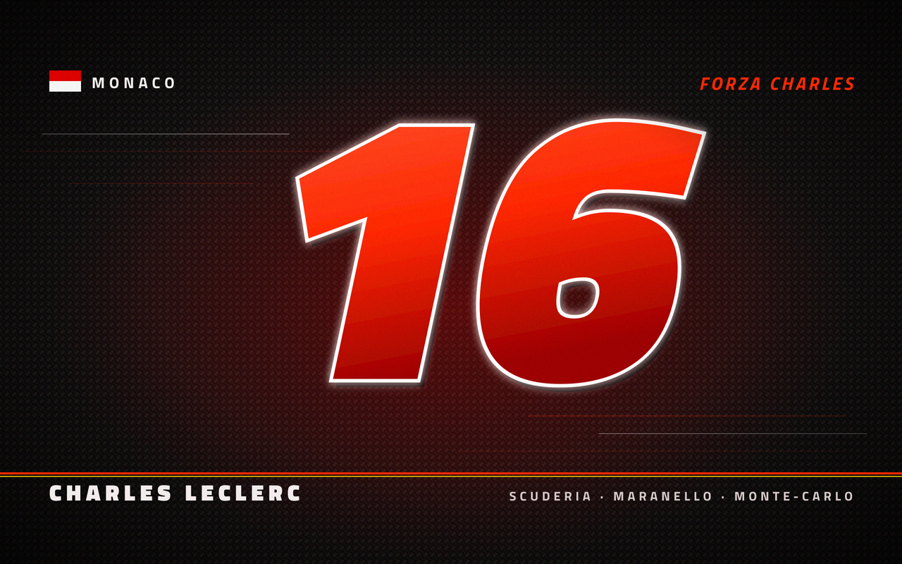

# Scuderia theme for Omarchy

A fan-made [Omarchy](https://omarchy.org) theme for Ferrari in F1 and Charles Leclerc.
It uses carbon-fibre black, Rosso Corsa red, livery white and a Giallo Modena yellow
accent, with Yaru-red icons. Window borders run from red into yellow.

> **Made with AI.** Claude (Anthropic) wrote this theme: the colours, the wallpaper
> generator script and this README. Minihercules317 came up with the idea, chose the
> photos, made the design choices and tested it on Omarchy.

## Install

    omarchy theme install https://github.com/Minihercules317/omarchy-scuderia-theme

Or go to Omarchy menu > Install > Style > Theme and paste the URL. To switch to it later:

    omarchy theme set scuderia

## Wallpapers

Wallpapers 01–03 are original art drawn by `src/wallpapers.py`. They don't use any
official logos (no prancing horse, no team wordmark).

1. `sedici`: Leclerc's #16 on carbon fibre
2. `monaco`: a stylised map of the Circuit de Monaco, marking his 2024 home win
3. `livery`: a sweep of bodywork with a #16 roundel

Wallpapers 04–09 are photos of Leclerc's cars from Wikimedia Commons, cropped to
2560x1600. Their credits and licences are listed below.

The drawn wallpapers keep their text 180px from the top and bottom edges, so 16:9
screens don't cut it off. Cycle wallpapers with `omarchy theme bg next`.

### Photo credits

All photos were cropped and scaled to 2560x1600. Nothing else was changed. The
cropped versions are shared under the same licence as their originals.

The licences cover the photographers' copyright only. The cars carry Ferrari and
sponsor trademarks, and the photos show identifiable people, which the licences don't
clear. The photo of `07-zandvoort-2024.jpg` was taken under FIA accreditation, and
its Commons page notes that FIA clears trademark and personality rights for
editorial use only. Use these photos as personal wallpapers, not commercially.

| File | Photographer | Licence | Source |
|------|--------------|---------|--------|
| `04-china-2026.jpg` | Liauzh | [CC BY 4.0](https://creativecommons.org/licenses/by/4.0/) | [2026 Chinese GP - Ferrari - Charles Leclerc - FP1.jpg](https://commons.wikimedia.org/wiki/File:2026_Chinese_GP_-_Ferrari_-_Charles_Leclerc_-_FP1.jpg) |
| `05-austria-2024.jpg` | Lukas Raich | [CC BY-SA 4.0](https://creativecommons.org/licenses/by-sa/4.0/) | [FIA F1 Austria 2024 Nr. 16 Leclerc.jpg](https://commons.wikimedia.org/wiki/File:FIA_F1_Austria_2024_Nr._16_Leclerc.jpg) |
| `06-suzuka-2024.jpg` | Cineyas | [CC BY-SA 4.0](https://creativecommons.org/licenses/by-sa/4.0/) | [SF-24 at the Japanese GP.jpg](https://commons.wikimedia.org/wiki/File:SF-24_at_the_Japanese_GP.jpg) |
| `07-zandvoort-2024.jpg` | Steffen Prößdorf | [CC BY-SA 4.0](https://creativecommons.org/licenses/by-sa/4.0/) | [2024-08-24 Motorsport, Formel 1, Großer Preis der Niederlande 2024 STP 3390 by Stepro.jpg](https://commons.wikimedia.org/wiki/File:2024-08-24_Motorsport,_Formel_1,_Gro%C3%9Fer_Preis_der_Niederlande_2024_STP_3390_by_Stepro.jpg) |
| `08-melbourne-2022.jpg` | EJ Mina | [CC BY 4.0](https://creativecommons.org/licenses/by/4.0/) | [Ferrari F1-75 in Melbourne.jpg](https://commons.wikimedia.org/wiki/File:Ferrari_F1-75_in_Melbourne.jpg) |
| `09-austria-2023-sparks.jpg` | Lukas Raich | [CC BY-SA 4.0](https://creativecommons.org/licenses/by-sa/4.0/) | [FIA F1 Austria 2023 Nr. 16 (3).jpg](https://commons.wikimedia.org/wiki/File:FIA_F1_Austria_2023_Nr._16_(3).jpg) |

## Optional: F1-style font (Titillium Web)

Omarchy fonts are global and aren't part of a theme, so switching themes never changes
them. To use Titillium Web, the typeface F1 used for years:

    mkdir -p ~/.local/share/fonts/scuderia
    cp ~/.config/omarchy/themes/scuderia/fonts/*.ttf ~/.local/share/fonts/scuderia/
    fc-cache -f
    omarchy font set "Titillium Web"

It isn't monospaced, so `omarchy font list` won't show it, but `font set` still works.
foot prints a warning about this. To silence it, add `font-monospace-warn=no` under
`[tweak]` in `~/.config/foot/foot.ini`.

To go back to the default font:

    omarchy font set "JetBrainsMono Nerd Font"

## Regenerating the wallpapers

The script needs Titillium Web visible to fontconfig. Either install it as above, or
point `FONTCONFIG_FILE` at a config that includes `fonts/`.

    python3 src/wallpapers.py sedici > sedici.svg   # or: monaco, livery
    rsvg-convert sedici.svg -o sedici.png

The shipped PNGs also have a light grain pass:
`magick in.png -attenuate 0.25 +noise Gaussian out.png`.

## License

- Theme files, `src/wallpapers.py` and wallpapers 01–03: MIT, see [LICENSE](LICENSE).
- `unlock.png`: the Omarchy logo, recoloured. MIT, © David Heinemeier Hansson.
- Photos 04–09: each under its own Creative Commons licence, listed in the table above.
- Fonts: SIL Open Font License, see `fonts/OFL-TitilliumWeb.txt`.

This is an unofficial fan project, not affiliated with or endorsed by Ferrari,
Formula 1 or Charles Leclerc. Their names and marks belong to their owners.
